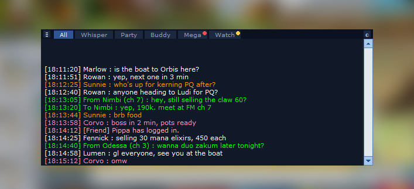
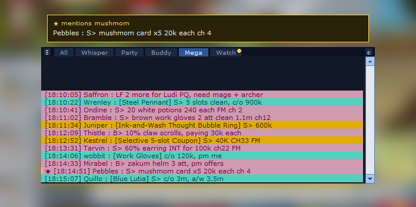
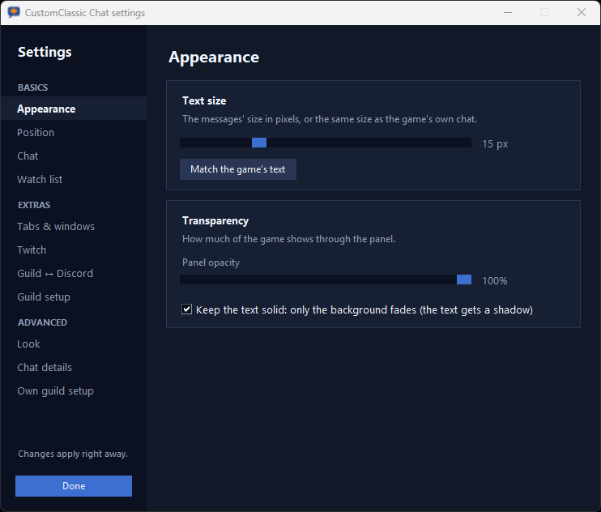
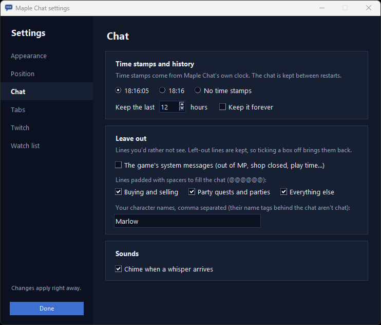
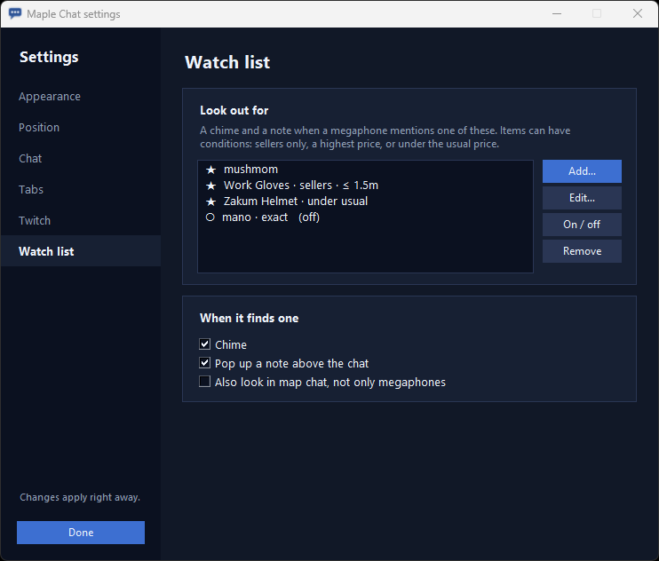

# CustomClassic Chat

**A customizable chat and smega blocker for MapleStory Classic World.**

A modern chat panel that sits exactly inside the game's own chat box and keeps the
**megaphones out of your chat**. Map chat, whispers, party and buddy
chat stay readable; megaphones get their own tab instead of flooding everything else.

Screenshots use invented players and chat over a blurred game scene.

- **Tabs** like modern MapleStory: All (everything but megaphones), Whisper, Party, Buddy, Mega
  and Watch, plus **a tab of your own** showing just the chat types you pick. A red dot marks
  a tab with messages you haven't seen.
- **Looks like the game:** megaphones on their pink, teal or gold band, green whispers,
  orange buddy chat, white map chat. Text size, colours, opacity and time stamps are adjustable.
- **Fits the game's chat box by itself** at any resolution or Windows scaling, follows the
  window when it moves or resizes, and follows the chat when you make it taller. It never
  covers the typing bar or the chat-target button, and it steps aside when the game shows
  a party invite or trade request over the chat.
- **Scrolls like the game's chat**, with its own scrollbar lying over the game's.
- **Chat history** is kept between restarts: 12 hours by default, or forever.
- **Watch list:** a chime and a pop-up when a megaphone mentions something you're after
  ("mushmom", "Work Gloves"). It can also check that someone is selling, and that the price
  is within a range you set.
- **Split the chat and add windows:** a second pane on top of the chat with its own tabs
  (Mega above, All below), or extra chat windows anywhere on screen, even outside the game.
- **See-through toggle (◐):** the messages turn 90% see-through and clicks go to the game's
  own chat underneath, until you click ◐ again.
- **Leaves the scenery out:** the game's chat box is see-through, so monster name tags,
  damage numbers and character names behind it are filtered out, not shown as chat.

Windows 10/11 only. The game has to run **windowed** or **borderless**.

> **Disclaimer.** CustomClassic Chat is third-party software, not made or endorsed by Nexon. It
> interacts with the game only in the way considered safe for such tools: it **reads what's
> on screen** with text recognition (OCR), much like a screen recorder or streaming software
> sees the game. It never opens the game's process, never reads or changes game memory or
> files, never touches the game's network traffic, and never sends any input to the game.
> Even so, Nexon's terms don't allow third-party programs, so no tool can promise your
> account is safe: **use it at your own risk.**

---

## Download

**[⬇ CustomClassicChat-win64.zip](https://github.com/mentulatv/customclassic-chat/releases/latest/download/CustomClassicChat-win64.zip)**
(the latest version, about 110 MB; nothing to install)

1. Unzip it anywhere, for example `Documents\CustomClassicChat`.
2. Start the game, then double-click **`CustomClassicChat.exe`**. CustomClassic Chat waits for the game, finds
   its chat box and settles into it. Its blue speech-bubble icon appears in the taskbar's
   notification area (bottom right, maybe behind the **^** arrow).

> Windows may say "Windows protected your PC", because the program isn't code-signed.
> Click **More info → Run anyway**.

Want to look around first? **`CustomClassic Chat demo.bat`** shows made-up messages without reading
anything. To update, unzip a newer version over the old folder: your settings and chat history
(`chat.json`, `chat_history.jsonl`) stay.

**Game settings:** any resolution and **UI Size** work; **1280×720 or larger** is recommended,
since smaller windows make the chat text tiny to read. Run the game **windowed**: an overlay
can't draw over a fullscreen game, so in the "(Full Screen)" resolutions the panel may not show.
Change the UI Size or resolution and CustomClassic Chat fits itself again within a few seconds.

### Running from source

Install **Python 3.11 or newer** ([python.org](https://www.python.org/downloads/), tick "Add
python.exe to PATH"), download this repository, double-click **`setup.bat`** once, then
**`start.bat`** (`start.bat --demo` for the demo). `build.bat` makes the .exe and the zip.

## Using it

**The tab row**

| | |
|---|---|
| **≡** (left end) | Drag up or down to make the panel taller or shorter, like the game's chat. |
| Tabs | Click to switch. A red dot means unread messages; a gold dot on Watch means your watch list caught something. |
| **◐** (right end) | See-through: messages 90% see-through and click-through until clicked again. |
| **+** (next to ◐) | Split the chat: a second pane on top with its own tabs (shown while it isn't split). |
| **⚠** (amber) | Only when the game's chat is minimised or shows one or two lines: megaphones arriving together may scroll away unread. Make the game's chat taller, or click ⚠ to hide it. |

**Scrolling:** the arrows (hold to keep going), the track, dragging the thumb, or the mouse
wheel. New messages don't pull you down while you're reading back.

**Tray icon:** left click shows or hides the panel. Right click: Show / hide, Adjust
position, Unlocked (place it anywhere), Reset position, Split the chat, New chat window,
See-through, Settings…, Quit.

**Right-click any chat window** for Split the chat, New chat window, Close this window,
See-through, Adjust position and Settings….

**Split the chat:** click **+** at the right end of the tab row (or right-click, the tray menu,
or Settings → Tabs). A second pane appears on
top of the chat, as wide as it and moving with it, with its own row of tabs: Mega to start with,
so megaphones sit above and your chat below. Drag the **divider bar** between the two to give one
more room and the other less; drag the split's ≡ to make the whole thing taller. Click its ✕ to
close it. A tab open in one pane gets no unread dot in the other.

**More chat windows:** tray menu or Settings → Position → **Add a chat window**. Each window
has its own tab and ◐, and goes anywhere you drag it: next to the game, on another screen. It
starts in adjust mode; press Ctrl+Alt+F5 to keep it where it is (Ctrl+Alt+F5 later moves all
windows again). Click its ✕ to close it. Windows and splits are remembered between restarts.

**Somewhere else entirely:** tick **Unlocked** (tray menu or Settings → Position) and drag the
panel anywhere, even off the game window or onto another monitor; drag its corner to resize,
then press Ctrl+Alt+F5 to keep it there. It still reads the game's own chat. If it ever ends up
out of reach, **Reset position** (tray menu, Settings, or Ctrl+Alt+F3) puts it back on the
game's chat box, and a panel left on a monitor that's gone comes back to the middle by itself.

**Hotkeys**

| Keys | Action |
|---|---|
| Ctrl+Alt+F5 | Adjust: drag to move, drag any edge or corner to resize, press again to save |
| Ctrl+Alt+F3 | Reset position: back on the game's chat box, fitted again |
| Ctrl+Alt+F6 | Hide / show |
| Ctrl+Alt+F7 | Quit |

## Settings

Right-click the tray icon → **Settings…**. Changes apply right away and are remembered.

 

- Text size (or match the game's), how see-through ◐ makes it, the panel's opacity
- Position: on the game's chat, or **unlocked** to go anywhere, and **Reset position**
- Time stamps: with seconds, without, or off. They come from CustomClassic Chat's own clock.
- How many hours of history to keep, or forever
- Colours of the background and of each chat type, and **Reset to default colours**
- Your character names, so their name tags behind the chat are left out
- Whether the game's system messages show (out of MP, shop closed, play time…)
- **Lines padded with spacers** (`S> claw 60 @@@@@@@@@@@@`), which crowded maps fill the chat
  with: leave them out by what they're about, with a box each for **buying and selling**,
  **party quests and parties** (LF KPQ, need 2 more) and everything else. All three are left
  out to start with. Left-out lines are kept, so unticking a box brings them back.
- **A tab of your own:** its name, and which of map chat, whispers, party, buddy/guild,
  megaphones, system messages and watch-list catches it shows (whispers, party and buddy
  to start with). Untick it to hide the tab.
- The whisper chime
- The watch list

## Twitch chat (opt-in)

Settings → tick **Twitch chat from the channel**, type the channel's name (or paste its
twitch.tv link) and press **Use**. Its chat shows in a **Twitch** tab, each chatter in their
own name colour, and in All too if you tick **Show it in All too**. The custom tab can show it
as well. CustomClassic Chat reads the chat as a guest, the way anyone can watch a channel's chat
without logging in: no account, key or password, and it never writes in the chat.

## Watch list

Settings… → **Watch list** → **Add…**. Each entry is a word or an item name:

- **A word** ("mushmom", "mano") fires on any megaphone that mentions it. Close spellings
  count, because text recognition sometimes reads "mushmom" as "mushrnom". Tick "This exact
  word only" to turn that off. Words under 5 letters always need the whole word.
- **An item** ("Work Gloves") gets name suggestions as you type, along with the shorthands
  chat uses for it ("wg"). You can then add conditions:
  - someone is **selling** it (S>), not buying
  - it costs **between** two prices you set, each (like `400k` and `1.5m`). Leave one side
    empty for no limit there: just a highest price, or just a lowest (handy to skip "1k"
    joke offers).

A hit plays a three-note chime, pops up a gold note above the chat for 12 seconds (click it
to open the Watch tab), and marks the line with a gold ★. The same entry and the same player
alert at most once every 10 minutes. You can also have it look in map chat, and turn the
chime or pop-up off.

Item names (the game's own) and their shorthands come from the
[Maple Price Index](https://mapleprice.mentula.tv); no prices come with them, the only prices
are the ones you type. CustomClassic Chat downloads the list once an hour and keeps a copy in
`cache/names.json`, so it still works offline.
That download (and, if you opt in, the Twitch chat you chose) is the only thing CustomClassic Chat
fetches. Your game chat never leaves your PC.

## How it works

About once a second, CustomClassic Chat asks Windows for a picture of the game window through
Windows Graphics Capture (the same way OBS's window capture works) and reads the chat lines
with [RapidOCR](https://github.com/RapidAI/RapidOCR). Because it reads the game window itself,
covering the game's chat doesn't stop it from reading. Each line's colours tell the chat types
apart: megaphones sit on a coloured band, whispers are green, and so on.

The chat box is measured in pixels: the line spacing from the text rows, the right edge where
the megaphone bands meet the game's scrollbar, and the bottom from the frame line above the
typing bar. That's why it fits at any resolution or scaling.

The game window is found by its title ("MapleStory"). Only window titles and positions are
asked for; the game's process is never opened.

## Files

| File | |
|---|---|
| `customclassic_chat.py` | the panel, tabs and the reading loop |
| `settings_ui.py` | the settings window |
| `twitch_chat.py` | Twitch chat, read as a guest |
| `reader.py` | text recognition and chat colours |
| `watch.py` | the watch list |
| `trade_parser.py`, `data/` | reads prices in megaphones (from the Maple Price Index) |
| `overlay.py` | the always-on-top overlay window and hotkeys |
| `chat.json` | your settings (made on first run) |
| `chat_history.jsonl` | the kept chat history (stays on your PC) |

Chat colours were measured on the Windia world. If a chat type shows in the wrong tab, copy
`config.example.toml` to `config.toml` and adjust the colours there.

## If something's off

- **Nothing shows up:** the game's chat box needs to show some lines. With the game in front,
  press Ctrl+Alt+F3.
- **It sits slightly wrong, or you can't find it:** tray icon → Reset position (or
  Ctrl+Alt+F3), or adjust it by hand with Ctrl+Alt+F5.
- **A yellow border around the game** (Windows 10): that's Windows showing a window is being
  captured. Windows 11 hides it.
- **Odd words in the chat:** see "Your character names" in Settings. Send a screenshot in an
  issue for anything else.

Try changes without the game: `python customclassic_chat.py --replay screenshot.png` prints which tab
each chat line of a saved screenshot lands in. Tests: `python -m pytest`.

## Roadmap

- **Discord channel** chat in its own tab (opt-in, like Twitch)
- **Chatting back**: logging in with Twitch or Discord to write in those chats from CustomClassic Chat

## License

MIT, see [LICENSE](LICENSE). Not affiliated with Nexon. MapleStory is a trademark of Nexon.
