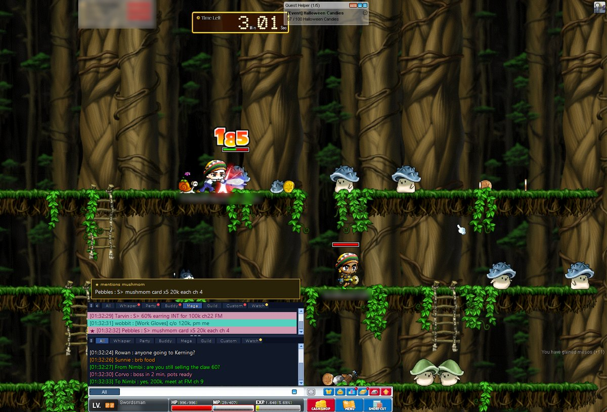
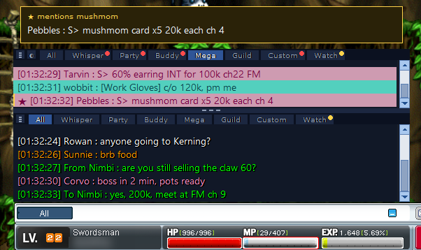

# CustomClassic Chat

**A chat overlay and smega blocker for MapleStory Classic World.**

- Megaphones in their own tab, out of your chat
- Tabs: All, Whisper, Party, Buddy, Mega, Watch and one of your own
- Watch list: a chime when a megaphone mentions what you're after
- Splits, extra windows, Twitch chat, guild chat ↔ Discord
- Light on your PC

The chat in the screenshots is made up; names in the game are blurred.

> **Disclaimer:** third-party software, not made or endorsed by Nexon. It only reads the screen:
> it never touches the game's process, memory, files, network or input. Nexon's terms still don't
> allow third-party programs, so **use it at your own risk.**

## Download

**[⬇ CustomClassicChat-win64.zip](https://github.com/mentulatv/customclassic-chat/releases/latest/download/CustomClassicChat-win64.zip)** (Windows 10/11)

1. Unzip it anywhere.
2. Run the game **windowed** or **borderless**, then `CustomClassicChat.exe`.

"Windows protected your PC"? Click **More info → Run anyway**. The app tells you when there's an
update: unzip it over the old folder.

## Using it

| | |
|---|---|
| **≡** or right-click | Menu: windows, splits, see-through, move, settings |
| **◐** | See-through |
| Tab row | Drag up or down to resize |
| **⚠** | The game's chat is too short or closed |

**Hotkeys:** Ctrl+Alt+F3 reset position · Ctrl+Alt+F6 hide · Ctrl+Alt+F7 quit

## Settings

Tray icon → **Settings…**

 

**Reading speed** (Advanced → Performance): Fastest by default. Balanced and Light save CPU but can
miss lines in heavy spam. A taller game chat helps most.

## Guild ↔ Discord

Admins: Settings → Guild ↔ Discord → **Add the bot**, then `/bind` in the channel. Members:
`/guildcode`, then **Join**. **[Setup guide →](docs/guild-setup.md)**

## Privacy

Your chat stays on your PC, except guild chat once you join a guild. The app downloads item names
for the watch list, and Twitch chat if you turn it on.

## Help

- **Nothing shows:** the game's chat needs a few lines. Press Ctrl+Alt+F3.
- **Chat in the wrong tab:** copy `config.example.toml` to `config.toml` and adjust the colours.
- **Anything else:** open an issue with a screenshot.

**From source:** `setup.bat` once, then `start.bat`. `build.bat` makes the zip; `python -m pytest` runs the tests.

MIT, see [LICENSE](LICENSE). Not affiliated with Nexon. MapleStory is a trademark of Nexon.
