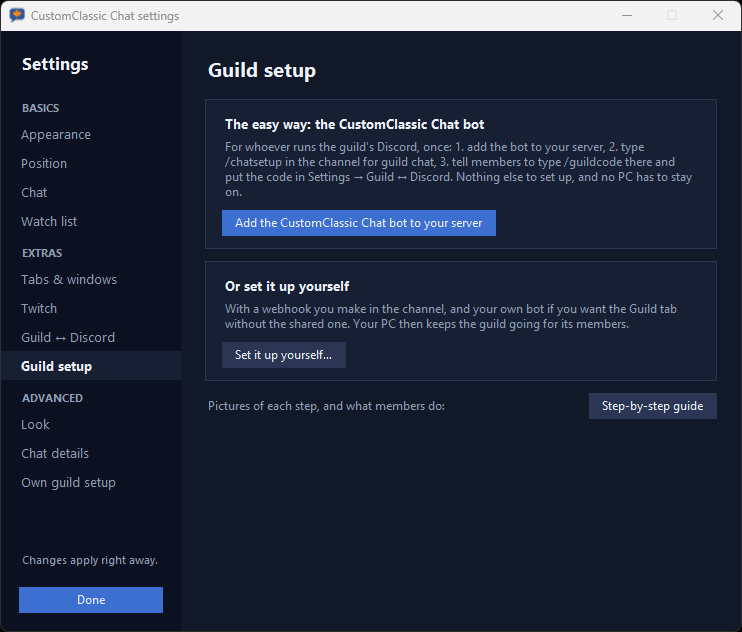
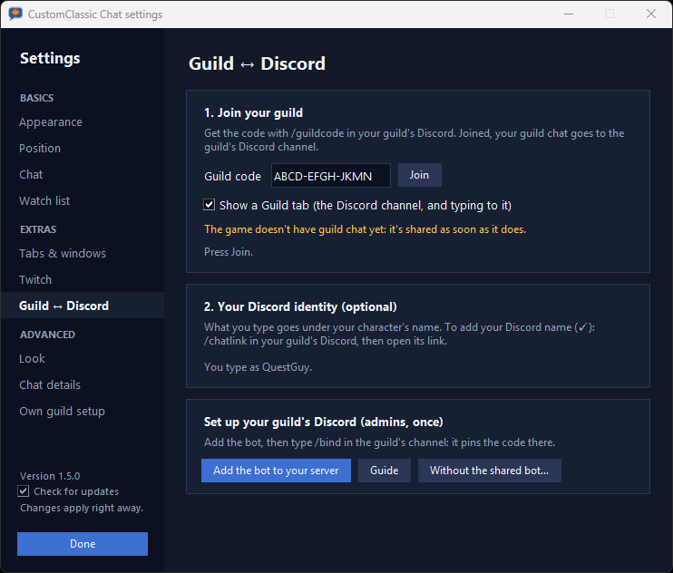

# Guild chat to Discord: setup guide

Your guild's in-game chat goes to a channel in your guild's Discord, and that channel comes back
into CustomClassic Chat as a **Guild** tab, where members can type to it too.

> The game doesn't have guild chat yet. Until it does, members can share **map chat** or
> **whispers** instead, to try everything out. Posts say which kind they are.

There are two parts:

- **[For the guild leader](#for-the-guild-leader-once)**: done once, in Discord, takes a minute.
- **[For every member](#for-members)**: put in the code, and optionally log in to type.

---

## For the guild leader (once)

You need permission to manage the Discord server (to add a bot), and a text channel for guild
chat, for example `#guild`. If it's a private channel, give the bot **View Channel**, **Send Messages** and **Read Message History** there after adding it.

1. **Add the bot.** In CustomClassic Chat: *Settings → Guild setup → Add the CustomClassic Chat bot
   to your server*. Pick your server and choose **Add to Server**. Don't choose *Add to My Apps*:
   that doesn't put the bot in your server.

   

2. **Set up the channel.** In the guild chat channel, type `/chatsetup`. It asks for:
   - **guild_name**: your guild's name in the game.
   - **join_with** (optional): `code` (the default, safer) or `name`.
     - **code:** members join with a code like `ABCD-EFGH-JKLM`.
     - **name:** members join with the guild's name. That's easier, but anyone who knows the name
       can read the shared chat and post to the channel.

   The bot makes a webhook for the channel and a guild code, and posts in the channel how to
   join. `/chatsetup` and `/chatstop` are for members who can manage webhooks.

3. **Tell your members.** Point them at that post, or at `/guildcode` (the bot answers only
   whoever asks), then at [For members](#for-members) below.

That's all. Nobody's PC has to stay on. The bot keeps the guild's details available and passes
Discord messages to the members' Guild tabs.

**To stop:** type `/chatstop` in the channel. Members' apps stop sharing, and the webhook is
removed.

---

## For members

### 1. Join

1. In your guild's Discord channel, type `/guildcode`. Only you see the answer.
2. In CustomClassic Chat: *Settings → Guild*. Paste the code (or the guild's name, if your guild
   uses that) and press **Join**.
3. Tick what you want:
   - **Share my chat**: your app helps send the guild's chat to Discord. Pick **Guild chat**, or,
     until the game has it, **Map chat** or **Whispers** to try it out.
   - **Show a Guild tab**: the Discord channel, and what members type, in a Guild tab.

The line under the boxes shows how it's going: the guild's name, how many members' apps are
online, and how many lines yours has shared.

**Sharing never makes copies.** Every member's app reads the same chat. The apps agree among
themselves which one posts each message, so a message is posted once however many members
share. More members sharing just means fewer gaps.

### 2. Log in to type (optional)

1. With CustomClassic Chat running, type `/chatlink` in your guild's Discord channel.
2. Open the link it gives you. It opens a page on your own PC that says
   *CustomClassic Chat is logged in as …*. You can close that tab.
3. Open the **Guild** tab, click the line at the bottom, type, and press **Enter**.

Put **your character's name** in *Settings → Guild* too. Your message goes to the Discord channel
and to every member's Guild tab under your character's name, with your Discord name after it when
the two differ (`islandgirl - @mentula`; just `mentula` when they match). The ✓ means the bot
vouched for the Discord name. A login lasts 90 days; then `/chatlink`
again. **Esc** or a click on the game gives the keyboard back to the game.

The link is yours alone: don't share it. *Settings → Guild → Log out* removes the login from this
PC.

---

## Own setup (advanced, without the shared bot)

If your guild would rather not use the shared bot: *Settings → Guild setup → Set it up
yourself…*

1. **A webhook:** in the guild chat channel, *Edit Channel → Integrations → Webhooks → New Webhook
   → Copy Webhook URL*, and paste it.
2. **Your own bot (optional),** for Discord messages in the Guild tab and `!guildcode`:
   discord.com/developers → *New Application → Bot*. Copy its token and switch on **Message
   Content Intent**. The app shows the link that adds it to your server. The token stays on your
   PC.
3. **The guild's name**, and whether members join with a code or the name. Press **Create**.

How to join is posted in the channel. With your own bot, Discord messages reach the members only
while your app is running. Logins (`/chatlink`) and typing come from the shared bot only.

---

## If something's off

| What you see | What to do |
| --- | --- |
| `/chatsetup` doesn't show up | Make sure the bot is in the server's member list; if not, add it again with **Add to Server**. Commands can take a minute to appear after adding. |
| *"Waiting for the guild's details…"* | The code is right, but no details have come yet. Give it a minute; check the code with `/guildcode`. |
| *"Not sharing"* | Tick **Share my chat**. |
| Nothing from Discord in the Guild tab | The bot can't see the channel (common with private channels): *Edit Channel → Permissions*, add **CustomClassic Chat**, allow **View Channel**, **Send Messages** and **Read Message History**. In an own setup without a bot, Discord messages don't come through at all. |
| Names show *(unverified)* | That message came from someone who isn't logged in, or logged in for another Discord server. |
| *"port 47321 is taken"* | Another program uses the port the login link needs. Close it and start CustomClassic Chat again. |
| The login link page says it isn't a working login | It ran out or was already replaced: `/chatlink` again. |

## Privacy

- **Only the chosen kind of chat is sent** (guild chat, or map chat or whispers for testing),
  with the speaker's name and the game's time stamp. Nothing else on your screen is sent, and
  nothing is ever typed into the game.
- **Encrypted from the code.** The members' apps meet through two free public message relays
  (MQTT). Messages are encrypted with a key made from the guild code, so the relays only pass
  sealed messages along.
- **Who can read and post:** anyone with the code (or the name, for guilds that join by name) can
  read the shared chat and post to the channel. Keep the code within the guild. If it leaks,
  `/chatstop` and `/chatsetup` again make a new one.
